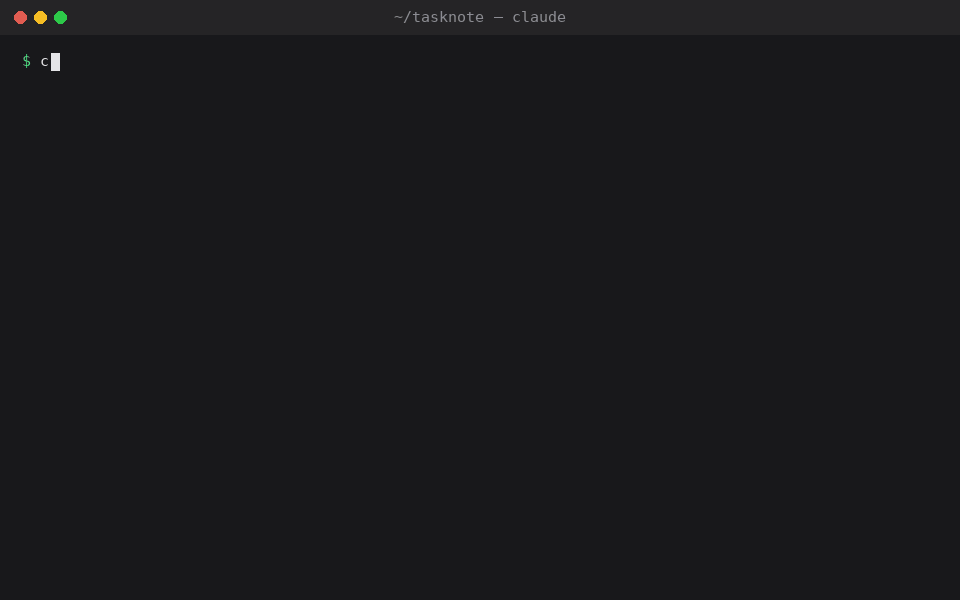

# vibe-preflight

A Claude Code skill that runs a pre-flight check on a vibe-coded app before it goes live —
like a pilot's checklist before take-off — and explains what it finds in plain language.

It covers more than security: deployment with Docker, runaway costs, unfinished code and
risky coding-agent settings, so you know whether the app is ready for real users.



<sub>Abridged from a real run on a small demo app (Next.js, Prisma, Postgres, OpenAI, Stripe,
Docker Compose) written with typical vibe-coding mistakes. The full report it wrote:
[sample-report.md](docs/demo/sample-report.md).</sub>

```
/vibe-preflight
```

It reads your project and writes two files to `.vibe-preflight/` (git-ignored):

- `report.md` — for you: what could go wrong, in plain words, and who fixes what
- `details.md` — for the agent or a developer: every technical detail needed to fix it

Then it asks which problems you want fixed. It changes nothing until you say so.

## What it checks

| Area | Examples |
| --- | --- |
| Security | keys in code or `.env` in git, secrets sent to the browser, one user reading another user's data, routes without login, SQL injection, unverified payment webhooks |
| Dependencies | packages that don't exist (hallucinated by the AI), known vulnerabilities, missing lockfile |
| Cost and abuse | paid AI/SMS/email APIs callable without login or limits, lists without pagination |
| Unfinished code | TODO stubs, fake data returned as real, hard-coded admin users, disabled auth checks |
| Deploy readiness | missing env docs, dangerous default secrets, dev mode in production, schema changes without migrations |
| Containers on a server | Docker Compose and Podman (including Quadlet): database ports open to the internet, host networking that exposes services, data without volumes, services that don't restart after a reboot |
| Hosting platforms | Vercel, Netlify, Cloudflare, Render, Railway, Fly.io: uploads saved to a disk that disappears, database connections running out, jobs that never run, public previews using real data |
| Dockerfile / Containerfile | `.env` copied into the image, dev server as `CMD`, running as root — and a multi-stage Dockerfile for Next.js, Vite SPAs, Node APIs and Python apps |
| Agent config | risky `allow` rules and hooks in `.claude/settings*.json`, tokens in `.mcp.json` |

## Install

Works in Claude Code, Codex and OpenCode. Pick one:

**Option 1 — with curl (no clone needed)**

```bash
curl -fsSL https://raw.githubusercontent.com/globalmpc/vibe-preflight/main/install.sh | bash                      # all: Claude Code + Codex (OpenCode reads both folders)
curl -fsSL https://raw.githubusercontent.com/globalmpc/vibe-preflight/main/install.sh | bash -s -- --target codex  # one harness: claude | codex | opencode | all
```

**Option 2 — from a cloned repo**

```bash
git clone https://github.com/globalmpc/vibe-preflight.git
cd vibe-preflight
bash install.sh                 # all: Claude Code + Codex (OpenCode reads both folders)
bash install.sh --target codex  # one harness: claude | codex | opencode | all
```

Run it again to update. Start the skill with `/vibe-preflight` in Claude Code; in Codex type
`$vibe-preflight` (or `/skills`); in OpenCode ask for "vibe-preflight" and the agent loads it.

## Use

```
/vibe-preflight            # everything that applies
/vibe-preflight security   # one area: security, dependencies, cost, unfinished, deploy, containers, platform, agent
/vibe-preflight apps/api   # one folder
/vibe-preflight lang=id    # reports in Bahasa Indonesia (any language: lang=es, lang=japanese …)
/vibe-preflight security lang=id   # combine with an area or folder
```

The skill asks once before contacting package registries (to check that packages exist and
have no known vulnerabilities). Only package names and versions are sent — never your code.

## Limits

- The audit only reads files; it does not run your app, scan your server, or test live
  endpoints. Settings that live only in a hosting dashboard become questions for you.
- After you approve fixes, how much it tests depends on your agent setup. The skill only asks
  it to re-check each fix (and to build a Dockerfile it wrote, if Docker is available).
  Some setups also run tests, start containers or call the running app; others stop at
  reading the code. Check the reports for anything marked "not verified" and run it yourself.
- Kubernetes manifests and Helm charts are not checked yet.
- Findings come from an AI reading your code. Each one cites a file and line so you can
  check it; anything uncertain is listed separately as "Needs a human look".
- It does not replace a professional security review for apps that handle money or
  sensitive personal data.

## License

MIT
